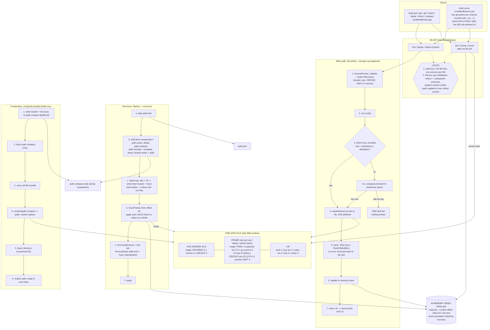

# Architecture and robustness proof

## Part 1: Architecture diagram

The source is `diagrams/architecture.mmd` (Mermaid). It shows the components,
the on-disk layout with field sizes, the numbered write ordering, the recovery
flow, the compaction flow and the locks.

### Components

| Component | Code |
|---|---|
| Client API | `internal/database/db.go`: `Open`, `Put`, `Get`, `Delete`, `Close`; `batch.go`: `NewBatch`, `Batch.Commit` |
| Write path | `db.go: (*DB).write` → `storage/log.go: (*Log).Append` |
| In-memory index | `index.go`: `map[string]valueRef` (value offset, value length, key length) |
| Log / frame writer | `storage/format.go: EncodeFrame`, `storage/log.go: Append` |
| Commit marker logic | `EncodeFrame` writes CRC32C + `"CMIT"` as the frame's last 8 bytes; `storage/scan.go: ScanFrames` accepts a frame only if both are right |
| Recovery | `db.go: Open` → `resolveCompactionTemp` → `storage.OpenLog` → `recovery.go: (*DB).recover` → `ScanFrames` + `Log.Truncate` |
| Compaction | `compact.go: (*DB).compactLocked` |
| Disk-full guard | `db.go: (*DB).write` (`fits`, `compactionWouldHelp`); `compact.go` refuses to exceed `MaxBytes` |
| Locks | `path.lock` (`storage/os_unix.go` flock, `os_windows.go` share-mode-0 handle); `DB.mu sync.RWMutex` |

### Write ordering (one put, one delete or one whole batch)

1. `EncodeFrame` builds **one** frame in memory: header, all ops, CRC32C, `CMIT`.
2. `mu.Lock()`.
3. Disk-full guard: if `size + len(frame) > MaxBytes`, compact if that helps.
   Otherwise return `ErrDiskFull` with nothing written.
4. `pwrite(frame, offset=size)` (`File.WriteAt`).
5. `fsync` (`File.Sync`, which is `fsync(2)` on Linux, `F_FULLFSYNC` on macOS
   and `FlushFileBuffers` on Windows). If step 4 or 5 fails, the file is
   ftruncated back to the old size and fsynced.
6. Update the in-memory index, all ops in order, still under `mu`.
7. Return nil. `serve` then prints `ACK <id>`.

## Part 2: Scenario-to-mechanism proof table

"torture X/seed" means `./torture --mode X --seed seed`. The numbers come from
the runs listed under "Verification runs" below. Unit tests are in
`tests/database_test.go` and run with `go test ./tests/`.

| Scenario | Disk state at the moment of the kill | Mechanism that handles it | Where in the code | Verified by |
|---|---|---|---|---|
| **A1** kill before any byte of a put reaches the file | File ends at the end of the previous valid frame; the new frame exists only in memory | Nothing to do: recovery scans all valid frames; the key has its previous value | `db.go: write` (before `log.Append`); `recovery.go: recover` | torture default/12345 (kills land while frames are being built); unit `TestTornTailAtEveryByte` (cut = 0 extra bytes) |
| **A2** torn write | File ends with a prefix of the new frame (partial header, or header plus part of the payload or trailer) | `ScanFrames` sees too few bytes (`remaining < 20+P`), or a CRC mismatch, or no `CMIT`. It stops there; `recover` ftruncates to the last valid frame end and fsyncs. Torn bytes are never parsed into the index | `storage/scan.go: ScanFrames`; `recovery.go: recover`; `storage/log.go: Truncate` | unit `TestTornTailAtEveryByte` (every cut point), `TestBadCommitMarkerOrCRC`; torture default/12345 |
| **A3** record fully written, not yet fsynced | The whole frame is in the OS page cache, which survives a process kill | The frame is valid, so recovery applies it. That is allowed because success was never returned. Other frames are untouched because we only ever append past the end | `log.go: Append` between `WriteAt` and `Sync` | torture default/12345 (counts as an in-flight op that may be present) |
| **A4** fsync returned, put not yet returned | Complete, fsynced frame | Recovery applies every valid frame, so the key has the new value | `log.go: Append` after `Sync`; `db.go: write` before return | torture default/12345 (in-flight op allowed present; the oracle accepts "ACKed + in-flight") |
| **A5** kill right after put returned success | Complete, fsynced frame (fsync happened before return) | Same as A4; the ACK is printed only after `write` returned nil | `serve.go: ackOrErr` / `emit`; `db.go: write` | torture default/12345: every ACKed op is checked present |
| **A6** kill during a delete | Delete frame is absent, torn or complete | A delete is a frame like a put: torn means ignored (key keeps its old value); complete means the key is absent. A delete never rewrites the old value's bytes | `db.go: Delete` → `write`; `index.go: applyScanned` | torture default/12345 (20% deletes); unit `TestTruncateOneByte` |
| **A7** kill during a 1 MB put | Frame of about 1 MB; any prefix may be on disk | Same as A1–A5. `remaining < 20+P` catches a short frame. CRC32C covers the whole payload | `scan.go: ScanFrames` | torture large-values/999; unit `TestTornTailAtEveryByte` (1 MB case, sampled cuts) |
| **B1** kill after 3 of 10 ops are written | A prefix of the single batch frame (all 10 ops are in **one** frame) | The frame is incomplete, so the whole frame is discarded and truncated. None of the 10 are visible | `batch.go: Commit` → `db.go: write` (one `EncodeFrame`, one `Append`); `scan.go` | unit `TestTornTailAtEveryByte`; torture default/12345 (writer state must equal acked or acked + **whole** in-flight batch) |
| **B2** all ops written, commit marker not | Frame present except the last bytes (`CMIT`, maybe CRC) | `remaining < 20+P` or `trailer[4:8] != "CMIT"`, so the frame is discarded | `scan.go: ScanFrames` | unit `TestBadCommitMarkerOrCRC` (flipped CMIT byte), `TestTornTailAtEveryByte` |
| **B3** commit marker written, not fsynced | Complete frame in the page cache | Valid frame, so all 10 ops are applied together by `applyScanned`. If power were lost and part were missing, the CRC or length check would discard all of them | `scan.go`; `index.go: applyScanned` | torture default/12345 |
| **B4** kill after batch returned | Complete, fsynced frame | Applied by recovery; all 10 visible | `db.go: write` (fsync before return) | torture default/12345 (ACKed batches checked) |
| **B5** batch puts X and deletes X | One frame with both ops in order | Ops are applied in written order, live (`write` loop) and in recovery (`applyScanned` loop): put-then-del leaves X absent, del-then-put leaves X set. Documented in README | `db.go: write`; `index.go: applyScanned` | unit `TestBatchOrdering` (live and after reopen) |
| **B6** 10,000-op batch killed halfway | Prefix of one large frame (about 300–500 KB) | Same as B1. Recovery reads at most one torn frame, then truncates | `scan.go`; `recovery.go` | torture large-batch/5 (writer 0 sends only 10,000-op batches); unit `TestRecoveryOneMillionKeys` (time) |
| **C1** kill during open() while replaying | File unchanged: `ScanFrames` only reads | The next open replays from scratch and reaches the same state | `scan.go: ScanFrames` (read-only) | torture recovery-crash/42 (`landed_in_recovery` > 0); unit `TestRecoveryIdempotent` |
| **C2** kill during open() while truncating a torn tail | Either the old size (torn tail still there) or the truncated size | `ftruncate` to the same offset is idempotent: the next open finds the same `ValidEnd` and truncates again, or finds nothing to cut | `recovery.go: recover`; `log.go: Truncate` | torture recovery-crash/42; unit `TestRecoveryIdempotent` |
| **C3** kill during compaction before the swap | `path` untouched; `path.compact` partial or complete | `path` is authoritative. `Open → resolveCompactionTemp` deletes `path.compact` | `compact.go: compactLocked` steps 1–3; `db.go: resolveCompactionTemp` | torture compaction/7 (`kill_during_compaction=true`); unit `TestLeftoverCompactionTemp` |
| **C4** kill in the middle of the rename | POSIX `rename(2)` is atomic: `path` names either the complete old file or the complete new one (fsynced before the rename) | Old: as C3. New: no temp file left, opened normally. If rename were not atomic and `path` were missing, `resolveCompactionTemp` promotes a temp file that scans cleanly | `compact.go: compactLocked` step 4; `db.go: resolveCompactionTemp`, `tempIsComplete` | torture compaction/7; unit `TestMissingMainWithCompleteTemp` |
| **C5** kill after the swap, before cleanup | `path` is the new compacted file; no temp file (rename consumed it) | Nothing is left to clean up. If a temp file from an earlier failed run exists, open deletes it | `compact.go` steps 5–6; `db.go: resolveCompactionTemp` | torture compaction/7 (checks no `.compact` after open); unit `TestLeftoverCompactionTemp` |
| **C6** kill during close() | Every ACKed frame was already fsynced; close only does one more fsync and closes handles | Same as any other kill | `db.go: Close`; `log.go: Close` | torture default/12345 (EOF and close are never needed for correctness; every iteration ends with SIGKILL) |
| **D1** two writers, different keys | Frames from both writers, appended one at a time under `mu` | `mu` serialises append + fsync + index update, so frames never interleave inside the file | `db.go: write` (`mu.Lock`) | torture default/12345 (two writers, private keys checked per writer) |
| **D2** two writers, same key | Same | Each frame is whole; the key holds the value of whichever frame came last. Values are never mixed because a value lives inside one CRC-checked frame | `db.go: write`; `scan.go` | torture default/12345 (shared `s-` keys: value must come from a real op not overwritten by a later ACKed one); unit `TestConcurrentWritersAndReaders` (`same` key) |
| **D3** one writer in a long batch, another doing single puts | Same | The batch is one frame; single puts are separate frames before or after it | `batch.go: Commit`; `db.go: write` | torture large-batch/5 (10,000-op batches + concurrent single ops) |
| **D4** reader during a batch, no crash | n/a | The index is updated for all ops of a batch inside one `mu.Lock` section; `Get`/`Dump` take `mu.RLock`, so they see before or after | `db.go: write`, `Get`, `Dump` | unit `TestConcurrentWritersAndReaders` (pair keys written by the same batch never differ in a `Dump`) |
| **E1** cap reached during a single put | Nothing new is written: the guard runs before `WriteAt` | `fits()` is false → optional compaction → `ErrDiskFull`. The file and index are unchanged | `db.go: write` (`fits`, `compactionWouldHelp`) | torture disk-full/3 (ERR must say "disk full" and the op must be absent); unit `TestDiskFull` |
| **E2** cap reached halfway through a batch | Nothing: the size check is on the whole frame before any byte is written | The batch fails as a whole; none of its ops are visible | `db.go: write` | unit `TestDiskFull` (batch rejected, keys unchanged); torture disk-full/3 (ERR batches checked absent) |
| **E3** cap reached, then killed | Valid frames up to below the cap | Normal recovery | `recovery.go` | torture disk-full/3 (kills after disk-full errors); unit `TestDiskFull` (reopen) |
| **E4** cap reached during compaction | `path` untouched; `path.compact` partial | `compactLocked` returns `ErrDiskFull` before the rename, deletes the temp file and keeps the old file | `compact.go: compactLocked` (`flush` size check) | unit `TestCompactionOverCap` |
| **E5** deletes free space, writes work again | Mostly dead frames | The next write that does not fit runs `compactLocked` automatically and then fits | `db.go: write` → `compactLocked` | torture disk-full/3 (`acks_after_full` > 0); unit `TestDiskFull` |
| **F1** 500 consecutive random kills | Any of the above | All of the above; the database file is kept across iterations | all | torture default/12345, 500 iterations |
| **F2** kill, restart, kill during recovery, again | Torn tail and/or partially truncated | Recovery is read-only except an idempotent truncate | `recovery.go` | torture recovery-crash/42 (1–3 open kills per iteration) |
| **F3** 1,000,000 keys, kill, open | About 31 MB file | Single sequential scan with a 4 MB buffered reader, CRC32C (hardware), pre-sized hash map | `scan.go: ScanFrames`; `db.go: Open` | unit `TestRecoveryOneMillionKeys` (about 0.5 s on our machine); manual: `./kvdb fill big.db 1000000` then `./kvdb open big.db` |
| **F4** file truncated by one byte | Last frame missing its last byte (`T` of `CMIT`) | `remaining < 20+P`, so the last frame is dropped. Only that one frame is lost | `scan.go`; `recovery.go` | unit `TestTruncateOneByte`; manual: truncate with any tool, then `./kvdb open` / `check` |

### Verification runs

Run on Linux (2 vCPU, ext4-style overlay filesystem) while writing this
document:

| Command | Result |
|---|---|
| `./torture --iterations 500 --seed 12345` | 500/500 passed, 375,078 ops ACKed, 1m59s |
| `./torture --iterations 100 --seed 999 --mode large-values` | 100/100 passed, 6,004 ops ACKed (256 KB to 1 MB values), 53s |
| `./torture --iterations 100 --seed 7 --mode compaction` | 100/100 passed, 83 of 100 kills landed while a compaction was in flight, 1m30s |
| `./torture --iterations 100 --seed 42 --mode recovery-crash` | 100/100 passed, 97 of 100 iterations killed `kvdb open` mid-recovery at least once, 1m48s |
| `./torture --iterations 100 --seed 5 --mode large-batch` | 100/100 passed, 79,996 ops ACKed (10,000-op batches), 1m29s |
| `./torture --iterations 100 --seed 3 --mode disk-full` | 100/100 passed, 206,818 clean "disk full" errors, 12,967 ACKs after a disk-full error, 33s |
| `go test ./tests/` | all 17 tests pass; 1,000,000-key recovery in about 0.5 s |

**Team TODO before submission:** re-run these on the demo laptop (Windows) and
update this table with those results.

Mutation check (showing the oracle is not rigged): we temporarily changed
`db.write` to write each op of a batch as its own frame. `torture --seed 777`
failed in iteration 1 with "batch w0.1-1 is PARTIALLY visible". We then
reverted the change.

## Part 3: The three guarantees

**1. Durability: once ACK is sent, the data survives.** `serve` prints
`ACK <id>` only after `DB.write` returned nil. `write` returns nil only after
`Log.Append` returned, and `Append` returns only after `File.WriteAt` wrote the
whole frame **and** `File.Sync` (`fsync`, or `FlushFileBuffers` on Windows)
returned without error. So when the ACK is on stdout, every byte of the frame,
including its CRC and `CMIT` marker, is on disk. Recovery never removes a valid
frame: it truncates only from the first invalid frame onward. That frame comes
after every fsynced frame, because appends are serialised under `mu` and a
failed append is truncated back before the next one starts. So an ACKed frame
is always replayed.

**2. Atomicity: a batch is never half visible.** A batch is encoded into a
single frame (`EncodeFrame`) and written with one `WriteAt` and one `Sync`.
On disk, recovery applies a frame only if all `20+P` bytes are present, the
CRC32C over the whole header and payload matches, and the `CMIT` marker is
there. Any missing or torn byte fails one of those checks, so either the whole
frame (all ops) is applied or none of it is. `ScanFrames` hands `applyScanned`
the complete list of a frame's ops only after validating the frame. In memory,
the index is updated for all ops of the batch inside one `mu.Lock()` critical
section after the fsync, and readers hold `mu.RLock()`, so a concurrent `get`
sees the state before or after the batch. A disk-full rejection happens before
any byte is written, so it cannot leave part of a batch.

**3. Recoverability: open() always succeeds on a file we produced.** The file
only changes in four ways:
- `WriteAt` + `Sync` of a frame at the end,
- `ftruncate` back to a frame boundary (rollback or recovery),
- writing the 16-byte header into a file shorter than 16 bytes,
- compaction's `rename(path.compact, path)` of a file that was fully written
  and fsynced first.

A kill at any point leaves one of three states:
1. a valid header followed by valid frames and possibly one torn frame, which
   recovery truncates,
2. a file shorter than 16 bytes, which recovery re-initialises because no frame
   could exist yet,
3. a leftover `path.compact`, which is deleted, or promoted if `path` is
   missing and the temp file scans cleanly.

Recovery itself only reads, then truncates to an offset it computed from the
data, then fsyncs. Running it again on the same file computes the same offset.
So a crash during recovery, or during compaction, just leads to another open
that does the same thing. The only case where open refuses is a header that is
present but not ours, which our code never writes.
