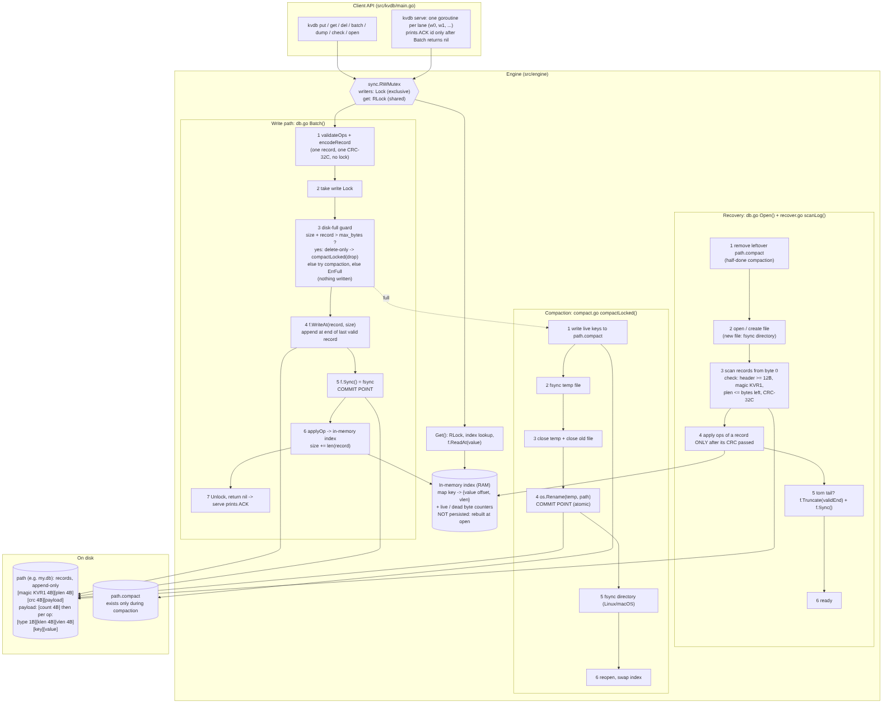

# ARCHITECTURE.md: why kvdb survives every scenario

## Part 1: Architecture diagram



The source is `diagrams/architecture.mmd` (Mermaid). It shows the components (client API, write path, in-memory index,
recovery, compaction, disk-full guard), the on-disk format with field sizes, the numbered write ordering, the recovery
flow and the lock.

**On-disk record** (the file has no header; it is records back to back, little-endian):

```
[magic "KVR1" 4B][plen uint32 4B][crc uint32 4B][payload plen B]
payload = [count uint32 4B] + count × ([type 1B][klen uint32 4B][vlen uint32 4B][key klen B][value vlen B])
crc     = CRC-32C(Castagnoli) over the 4 plen bytes followed by the payload
```

**Commit marker.** We have no separate commit marker: the record's CRC *is* the commit marker. A record counts only if
all `12 + plen` bytes are present and the CRC matches, so "marker written but data missing" cannot happen. The
durability commit point is `f.Sync()` in `Batch`; for compaction it is `os.Rename`.

**Index.** A `map[string]{offset, vlen}` in RAM. It is never persisted; `Open` rebuilds it by scanning the log.

**Lock.** One `sync.RWMutex` in `DB`. `Batch`, `Compact` and `Close` take `Lock`; `Get`, `Keys`, `Len` and `Size`
take `RLock`.

## Part 2: Scenario-to-mechanism proof table

Torture commands use `bin/torture` (`bin\torture` on Windows). "mixed" is the default mode. Unit tests are in
`tests/engine_test.go`.

| # | Disk state at the moment of the kill | Mechanism that handles it | Where in the code | Verified by |
|---|---|---|---|---|
| A1 | No bytes of the new record. File ends at the last valid record. | Nothing to recover. The op was never ACKed. | `db.go Batch` (before `f.WriteAt`) | mixed `--seed 12345`: kills between writes |
| A2 | A prefix of the record: a partial 12-byte header, or a full header with fewer than `plen` payload bytes. | `scanLog` stops ("torn header" / "torn record"); `Open` truncates to the record start and fsyncs. | `recover.go scanLog`, `db.go Open` | `TestTornTailAtEveryByte` (cut at every byte); large-values `--seed 999` |
| A3 | The full record has been written (in the OS cache) but the fsync has not returned. | The CRC passes, so it is replayed. That is legal because it was never ACKed. Any other record is untouched because we only append. | `db.go Batch` (`f.WriteAt` → `f.Sync`) | mixed: on our laptop almost every kill lands during the fsync (in-flight=2 per iteration) |
| A4 | The full record is durable; `Batch` has not returned. | Replayed: the key is present with the new value. | `db.go Batch` (after `f.Sync`) | mixed: the oracle allows in-flight ops to be present; this exact instant is not isolated |
| A5 | The full record is durable and ACK was printed. | Replayed. The oracle requires it. | `db.go Batch`, `main.go serve` (`reply("ACK")`) | mixed `--seed 12345`, 500 iterations |
| A6 | A delete record (type 2, vlen 0) is torn or complete. | Same as A2/A3: a torn delete is dropped (old value stays); a complete one is replayed (key absent). The record holds no value bytes, so no value can be corrupted. | `record.go encodeRecord`, `recover.go scanLog` | mixed (15% single deletes, 20% of batch ops) |
| A7 | A prefix of a ~1 MB record spanning many disk blocks. | Same as A2: `plen` > bytes present, or a CRC mismatch, so it is truncated. | `recover.go scanLog` | large-values `--seed 999` (80% of values are 256 KB–1 MB, half of those exactly 1 MB) |
| B1 | Part of a batch record (e.g. 3 of 10 ops' bytes). | The whole record fails the length or CRC check and is truncated. Ops are applied only after the CRC passes. | `recover.go scanLog` (apply loop after the CRC check) | `TestTornTailAtEveryByte` (the last record is a 3-op batch); large-batch |
| B2 | All op bytes written, but the record is incomplete or the CRC is unverified. | There is no separate marker: an incomplete record has `plen` > bytes present, so none of the 10 are visible. | `recover.go scanLog` | `TestTornTailAtEveryByte`: the cut at the last byte keeps all 3 ops invisible |
| B3 | The complete batch record, before the fsync. | The CRC passes and all ops are replayed together, or (if lost) none are. One CRC means never some. | `db.go Batch`, `recover.go scanLog` | large-batch `--seed 5`; the oracle checks in-flight batches for PARTIAL BATCH |
| B4 | The batch record is fsynced and ACKed. | Replayed; all ops are visible. | `db.go Batch` | mixed and large-batch: the oracle requires every op of an ACKed batch |
| B5 | A batch with `put X` and `del X`. | Ops are applied in order, so the last op wins (documented in the README). Recovery replays in the same order. | `db.go applyOp`, `recover.go scanLog` | `TestBatchOrdering`; the oracle computes effects last-wins |
| B6 | A 10,000-op batch record, half written. | Truncated as in B1. The scan stays linear, so recovery stays fast. | `recover.go scanLog` | large-batch `--seed 5` (batches of 5,000–10,000) |
| C1 | Unchanged: recovery was only reading. | The scan has no side effects, so the next `Open` repeats it from byte 0. | `recover.go scanLog` | recovery-crash `--seed 42` (kills `kvdb open` 1–3 times per iteration) |
| C2 | The torn tail is either cut or still present. | `Truncate(validEnd)` is idempotent; the next scan finds the same `validEnd`. | `db.go Open` (`f.Truncate`, `f.Sync`) | recovery-crash `--seed 42`; `TestTornTailAtEveryByte` (second open truncates 0 bytes) |
| C3 | The main file is complete; `path.compact` is partial or complete. | The rename never happened, so the main file is authoritative; `Open` deletes the temp file. | `compact.go compactLocked`, `db.go Open` (`os.Remove`) | compaction `--seed 7`; `TestLeftoverTempFile` |
| C4 | Rename in progress. | `rename` atomically replaces `path` with the already-fsynced temp file: exactly one complete file. | `compact.go compactLocked` (`tf.Sync` before `os.Rename`) | compaction `--seed 7` (kills land in compaction randomly; the exact rename instant is not isolated). Relies on rename atomicity (see BREAKING weakness 2) |
| C5 | `path` is the new file; no temp file remains (the rename consumed it). | `Open` recovers from the new file; it removes a temp file if one exists. | `db.go Open`, `compact.go compactLocked` | compaction `--seed 7`; `TestLeftoverTempFile` |
| C6 | Nothing pending: every ACKed write was already fsynced. | `Close` only re-syncs and closes, so a kill here equals a kill at any other time. | `db.go Close` | not verified by a dedicated test (argument only) |
| D1 | Records from two writers, appended one at a time. | The global `Lock` serializes appends; each record is complete or torn at the tail only. | `db.go Batch` (`db.mu.Lock`) | mixed: 2 writers (`--writers 2`), every ACKed op checked |
| D2 | Two records for the same key, in lock order. | Whole records only, so the value is one writer's complete value. The last record wins. | `db.go Batch`, `applyOp` | mixed (300 shared keys); self-checking values detect a mix of two |
| D3 | A long batch record and single-put records. | The batch is atomic (B1–B4); single puts are independent records. | `db.go Batch` | mixed (batches 2–40 ops alongside single puts); large-batch |
| D4 | No crash. | `Get` takes `RLock`; `Batch` updates the index only while holding `Lock`, after the fsync. A reader sees all of a batch or none of it. | `db.go Get`, `Batch` | mixed: the reader thread checks every value is complete and belongs to its key. Partly verified: cross-key snapshot consistency is argued, not tested |
| E1 | Unchanged. | Checked before writing: `size + len(record) > MaxBytes` returns `ErrFull`; nothing is written. | `db.go Batch` (disk-full guard) | disk-full `--seed 3` (`--max-bytes 262144`); `TestMaxBytes` |
| E2 | Unchanged. | The whole batch is one record, checked as a unit, so none of its ops are visible. | `db.go Batch` | `TestMaxBytes` (batch over the limit leaves the size unchanged); disk-full: FULL ops must never appear |
| E3 | A valid log ≤ max_bytes. | Normal recovery. `ErrFull` never wrote a byte. | `db.go Open` | disk-full `--seed 3`: kill after FULL errors, then open, check, dump |
| E4 | Compaction writes only to `path.compact`; the main file is untouched until the rename. | On any temp-file error (incl. a real ENOSPC) the temp file is removed and the old file stays authoritative. Compaction only drops dead data, so the new file is no larger than the old one apart from at most 16 bytes of record header per 8 MB chunk. | `compact.go compactLocked` (abort path) | disk-full mode triggers compaction at the limit; real ENOSPC not verified |
| E5 | — | A delete-only batch at the limit runs `compactLocked(drop)`, which rewrites without those keys. A put at the limit compacts first when `compactionWouldMakeRoomLocked` says it helps, then retries. | `db.go Batch`, `compact.go` | `TestMaxBytes` (deletes while full, then put succeeds); disk-full mode |
| F1 | Any of the above, 500 times in a row. | All of the above; the oracle baseline carries over between iterations. | — | mixed `--iterations 500 --seed 12345`: <<your result>> |
| F2 | As C1/C2, repeated. | Recovery is idempotent. | `db.go Open` | recovery-crash `--seed 42`: <<your result>> |
| F3 | 1,000,000 keys in 100 records of 10,000. | Linear scan, 4 MB buffered reader, map insert per key. | `recover.go scanLog` | `--mode million`: 1.39 s on Linux; <<your laptop result>> |
| F4 | The last record is 1 byte short. | The last record is torn, so it is truncated; everything before it is intact. | `recover.go scanLog`, `db.go Open` | `TestTornTailAtEveryByte` (includes the cut at length − 1) |

## Part 3: The three guarantees

**1. Durability: once ACK is sent, the data survives.** `serve` prints `ACK <id>` only after `db.Batch` returns nil.
`Batch` returns nil only after `f.WriteAt(record, size)` has written every byte *and* `f.Sync()` (fsync on Unix,
`FlushFileBuffers` on Windows) has returned. The task says the disk is honest once fsync returns, so the record is on
disk. Nothing ever overwrites an existing record: appends go to `size`, compaction writes to a separate file, and
truncation only removes bytes past the last valid record. So a durable record is never damaged later. Recovery replays
every record before the first invalid one, and a durable record has no invalid record before it, because each earlier
record was itself fsynced before this one was written.

**2. Atomicity: a batch is never half visible.** A batch is encoded into **one** record with **one** CRC-32C covering
its length field and all of its ops. On disk it is either complete with a matching CRC, or not counted: `scanLog`
rejects a record when fewer than `12 + plen` bytes exist or the CRC differs, and it applies ops to the index only after
that check passes. In memory, `Batch` holds the exclusive lock and changes the index only after the fsync, while `Get`
holds the shared lock, so a reader sees the index before or after the whole batch. Compaction rewrites only live
values and commits them with a single `rename`, so it cannot expose part of a batch either.

**3. Recoverability: `open()` always succeeds on a file we produced.** A file we produced is a run of valid records,
optionally followed by a torn prefix of one record, plus possibly a leftover `path.compact`. `Open` (a) deletes the
leftover temp file: it is never authoritative because the rename is the commit point. (b) `scanLog` reads records and
stops at the first one that is short, has the wrong magic, has an impossible `plen` or fails the CRC. It never errors
on bad data, only when the OS itself fails a call (read, truncate, remove). (c) `f.Truncate(validEnd)` then `f.Sync()`. Steps (a)–(c) change
nothing that a later run would read differently: deleting an absent file and truncating to the same length are no-ops,
and the scan is read-only. So a kill at any point inside `Open` leaves a file on which the next `Open` does the same
work and reaches the same state.