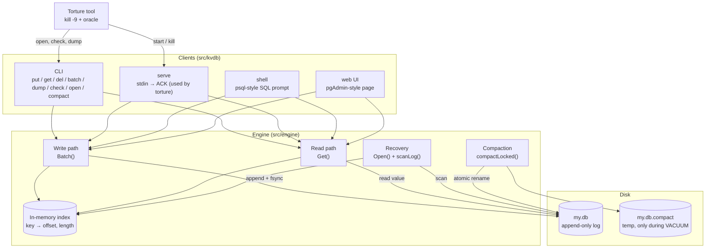

# DESIGN.md: high-level and low-level design of kvdb

kvdb is a crash-safe, embedded key-value store written in Go with no third-party libraries. All data lives in one
**append-only log file**, and an **in-memory hash index** makes reads fast. Every write is fsynced before it is
acknowledged.

- [Part 1: high-level design](#part-1-high-level-design) covers what the parts are and how they connect.
- [Part 2: low-level design](#part-2-low-level-design) covers what is inside each part: structs, bytes, steps, locks and errors.

---

# Part 1: high-level design

## 1.1 System overview



The same picture as plain text:

```
                ┌─────────────────────────────────────────────┐
   CLIENTS      │  CLI      serve (stdin→ACK)    shell    UI   │
                └──────────────────────┬──────────────────────┘
                                       │ Put / Get / Delete / Batch / Compact
                ┌──────────────────────▼──────────────────────┐
   ENGINE       │  Write path ──▶ In-memory index ◀── Recovery │
                │       │              ▲                │      │
                │       │          Read path            │      │
                │       │      Compaction (VACUUM)      │      │
                └───────┼──────────────┼────────────────┼──────┘
                        ▼              ▼                │
   DISK         ┌─────────────────────────────┐        │
                │ my.db       (append-only)    │◀───────┘
                │ my.db.compact (temp file)    │
                └─────────────────────────────┘

   TESTING      torture ──start──▶ serve ──kill -9──▶ open / check / dump ──compare──▶ oracle
```

## 1.2 Components

| Component | Responsibility | Code |
|---|---|---|
| **CLI** | One-shot commands: open, put, get, del, batch, dump, check, compact | `src/kvdb/main.go` |
| **serve** | Long-running mode. Reads ops on stdin and prints `ACK` only after the data is on disk. Runs one goroutine per lane, so writers really run concurrently. | `src/kvdb/main.go` |
| **shell** | psql-style prompt: SQL, `\d`, `\l`, `\c`, `\torture` | `src/kvdb/shell.go`, `sql.go` |
| **web UI** | pgAdmin-style page: dashboard, table viewer, query tool, torture tab | `src/kvdb/ui.go`, `ui.html` |
| **Write path** | Turns every write into one checksummed record, appends it, fsyncs, then updates the index | `src/engine/db.go`, `record.go` |
| **In-memory index** | `key → (file offset, length)` for fast reads. Never saved to disk; rebuilt at startup. | `src/engine/db.go` |
| **Read path** | Looks a key up in the index, then reads its value from the file | `src/engine/db.go` |
| **Recovery** | On open: reads the log, rebuilds the index, cuts off a half-written end | `src/engine/recover.go`, `db.go` |
| **Compaction** | VACUUM: writes only live data to a new file and swaps it in with an atomic rename | `src/engine/compact.go` |
| **Integrity check** | Read-only checksum scan of the whole file | `src/engine/check.go` |
| **Torture tool** | Proves the guarantees: starts serve, sends random writes, kills it, verifies against its own oracle | `torture/` |

## 1.3 Guarantees

| Guarantee | Meaning | How |
|---|---|---|
| **Durability** | Once ACKed, the data survives any crash | fsync before ACK; records are never overwritten |
| **Atomicity** | A batch is all or nothing | The whole batch is one record with one CRC |
| **Recoverability** | A file kvdb wrote always opens | Recovery stops at the first bad record and truncates; every step can be repeated |

## 1.4 Main flows

| Flow | Steps |
|---|---|
| **Write** | client → `Batch()` → encode record → lock → size check → append → **fsync** → index → ACK |
| **Read** | client → `Get()` → shared lock → index lookup → read value from file |
| **Startup** | `Open()` → delete leftover temp file → scan log → rebuild index → truncate torn tail |
| **VACUUM** | write live keys to temp → fsync → **rename** over the old file → reopen |
| **Torture** | start serve → 2+ writers → random SIGKILL → open, check, dump → compare with oracle → repeat |

## 1.5 Design decisions

| Decision | Why | Trade-off |
|---|---|---|
| Append-only log | A crash can only damage the end of the file, never older data | The file grows until VACUUM |
| One record per batch, one CRC | Atomicity for free, with no separate commit marker | A batch is limited to 64 MB |
| Index in memory, values on disk | Fast reads, small memory use | Recovery must re-read the whole file |
| fsync on every write | Simple, and the ACK is honest | About 25–30 writes per second on our laptop |
| One global lock | Easy to reason about, no partial batches visible | Writers wait for each other |
| Rename as the compaction commit | Atomic, so the old or new file is always complete | Needs free space for a second copy |
| Go standard library only | The rules ban storage libraries; the code is easy to explain | – |

---

# Part 2: low-level design

## 2.1 On-disk format

All integers are **little-endian** (`binary.LittleEndian`): the least significant byte comes first, the native order of x86 and ARM.

```
File      = Record, Record, Record, ...            (no file header)

Record    ┌──────────┬──────────┬──────────┬───────────────────┐
          │  magic   │   plen   │   crc    │      payload      │
          │  "KVR1"  │  uint32  │  uint32  │    plen bytes     │
          │  4 bytes │  4 bytes │  4 bytes │                   │
          └──────────┴──────────┴──────────┴───────────────────┘
          crc = CRC-32C (Castagnoli) over the 4 plen bytes + payload

Payload   ┌──────────┬────────┬────────┬─────┐
          │  count   │  op 1  │  op 2  │ ... │        count = 1 .. 10,000
          │  uint32  │        │        │     │
          └──────────┴────────┴────────┴─────┘

Op        ┌──────┬────────┬────────┬────────┬──────────┐
          │ type │  klen  │  vlen  │  key   │  value   │
          │  1B  │ uint32 │ uint32 │ klen B │  vlen B  │
          └──────┴────────┴────────┴────────┴──────────┘
          type 1 = put, 2 = delete (vlen = 0)
          klen 1..1024, vlen 0..1,048,576
```

**Example:** `put a 1` on an empty file is exactly 27 bytes:

```
4b 56 52 31 | 0f 00 00 00 | 49 b5 af ca | 01 00 00 00 | 01 | 01 00 00 00 | 01 00 00 00 | 61 | 31
  "KVR1"       plen=15        crc          count=1     put   klen=1        vlen=1        "a"  "1"
```

Keys and values are stored **raw**: no encoding, compression or encryption.

## 2.2 Data structures (`src/engine/db.go`)

```go
type DB struct {
    mu     sync.RWMutex       // writers: Lock (exclusive); readers: RLock (shared)
    path   string
    opts   Options            // MaxBytes, ReadOnly, AutoCompactMinBytes
    f      *os.File           // the open .db file
    index  map[string]entry   // key → where its value is
    size   int64              // end of the last valid record = where the next record goes
    live   int64              // bytes of current ops      (op header + key + value)
    dead   int64              // bytes of garbage ops      (what VACUUM reclaims)
    closed bool
    broken error              // set after a failed fsync: writes refused until restart
    info   RecoveryInfo       // what the last Open() found
}

type entry struct {
    off  int64                // file offset of the value bytes
    vlen uint32               // value length
}

type Op struct {
    Type  byte                // OpPut (1) or OpDelete (2)
    Key   []byte
    Value []byte
}
```

Memory cost: about 16 bytes per key plus the key itself. Values are never kept in RAM.

## 2.3 Public API

| Function | Behaviour |
|---|---|
| `Open(path, opts) (*DB, error)` | Create or open, then run recovery (2.6) |
| `Put(key, value) error` | A batch of 1 put |
| `Delete(key) error` | A batch of 1 delete. A missing key is not an error. |
| `Batch(ops []Op) error` | Atomic. Ops apply in order, so the last op on a key wins. |
| `Get(key) (value, found, error)` | Index lookup + `ReadAt` |
| `Compact() error` | VACUUM (2.7) |
| `Keys() []string`, `Len()`, `Size()`, `Stats()` | Read-only helpers |
| `Close() error` | Sync and close (nothing is pending) |
| `Check(path) (CheckReport, error)` | Read-only checksum scan |

## 2.4 Write path (`Batch()`)

| # | Step | Code | If the process dies here |
|---|---|---|---|
| 1 | Validate limits, encode one record with its CRC (no lock held) | `validateOps`, `encodeRecord` | Nothing on disk |
| 2 | Take the exclusive lock | `db.mu.Lock()` | Nothing on disk |
| 3 | Size check: `size + len(record) > MaxBytes`? Delete-only → compaction without those keys; otherwise compact if that would help, else `ErrFull` | `compactionWouldMakeRoomLocked` | Nothing on disk |
| 4 | Append at the end of the last valid record | `f.WriteAt(record, size)` | Torn tail → cut at open |
| 5 | **fsync: the commit point** | `f.Sync()` | Complete record → replayed |
| 6 | Update the index and counters | `applyOp` | Durable → replayed |
| 7 | Unlock, return nil → serve prints `ACK` | | Durable → replayed |
| 8 | Auto-VACUUM if the file is ≥ 8 MB and more than half garbage | `maybeAutoCompactLocked` | See 2.7 |

**On errors:** a failed `WriteAt` truncates back to `size`. A failed `Sync` marks the DB `broken`, so no more writes until a restart re-reads the file.

## 2.5 Read path (`Get()`)

```
RLock → e := index[key] → (missing? NOTFOUND) → buf := make([]byte, e.vlen) → f.ReadAt(buf, e.off) → RUnlock
```

A reader holds the shared lock and a writer changes the index only while holding the exclusive lock, after the fsync.
So a reader sees the state from **before or after** a batch, never in between.

## 2.6 Recovery (`Open()` + `scanLog()`)

```
1. remove  my.db.compact                (a half-done VACUUM is never authoritative)
2. open or create my.db                 (new file → fsync the folder, Linux/macOS)
3. off = 0
   loop:
     fewer than 12 bytes left?        → stop  (torn header)
     magic != "KVR1"?                 → stop
     plen > 64 MB or > bytes left?    → stop  (torn record)
     read payload; CRC mismatch?      → stop
     decode payload; bad lengths?     → stop
     apply every op to the index     ← only now, after the whole record passed
     off += 12 + plen
4. if off < file size: Truncate(off) + Sync()
```

**Idempotent:** the scan only reads, and truncating to the same length twice is a no-op. A crash at any point inside
recovery leads to the same result on the next open.

Measured: **1,000,000 keys recover in 591 ms** on our Windows laptop (limit 2,000 ms).

## 2.7 Compaction (`compactLocked()`)

| # | Step | If the process dies here |
|---|---|---|
| 1 | Create `my.db.compact` (truncate if leftover) | Old file intact; temp deleted at open |
| 2 | Write every live key as records (≤ 10,000 ops or 8 MB per record) | Same |
| 3 | `fsync` the temp file | Same |
| 4 | Close the temp file and the old file (Windows cannot rename over an open file) | Same |
| 5 | **`rename(my.db.compact, my.db)`: the commit point, atomic** | Either the old or the new file is complete |
| 6 | `fsync` the folder (skipped on Windows) | New file in place |
| 7 | Reopen, switch to the new index, `dead = 0` | New file in place |

Any error before step 5 deletes the temp file and keeps the old file.

## 2.8 Concurrency

| Who | Lock |
|---|---|
| `Batch`, `Compact`, `Close` | `Lock` (exclusive) |
| `Get`, `Keys`, `Len`, `Size`, `Stats` | `RLock` (shared) |
| `encodeRecord` | none (done before locking, so CPU work is outside the lock) |

`serve` gives every lane (the id prefix before the dot, e.g. `w0`, `w1`) its own goroutine, so ops from different
writers reach `Batch` at the same time and are serialized by the lock. Ops inside one lane stay in order.

There is **no lock between processes**. Two processes writing one file will corrupt it (BREAKING.md, weakness 4).

## 2.9 Errors

| Error | Cause | Effect on disk |
|---|---|---|
| `ErrInvalid` | Empty or too-long key, value over 1 MB, 0 or more than 10,000 ops | None |
| `ErrFull` | The write would exceed `--max-bytes` | None |
| write error | e.g. a real disk-full | Partial record truncated |
| fsync error | Disk or OS failure | DB marked `broken`; restart required |
| `ErrClosed` / `ErrReadOnly` | Misuse | None |

## 2.10 Limits

| Item | Limit |
|---|---|
| Key | 1–1024 bytes |
| Value | 0–1 MB |
| Ops per batch | 1–10,000 |
| Record payload | 64 MB |
| File size | `--max-bytes` (optional) |
| Keys | Tested with 1,000,000 |

## 2.11 Torture tool internals (`torture/`)

| Part | How |
|---|---|
| **Self-checking values** | `opid|key|length|filler`, where the filler is derived from the first three fields. Any value read back proves which op wrote it, for which key, and that it is complete. |
| **Event clock** | Each op gets `send` (before it is written to stdin) and `ack` (after `ACK` is read). If `a.ack < b.send`, then a was applied before b. |
| **Oracle rules** | ACKed → must be visible unless a later ACKed op replaced it. In flight → may or may not be visible. `ERR FULL` → must not be visible. Batch → all or nothing. |
| **Kill** | `Process.Kill()` = SIGKILL / TerminateProcess after a seeded random delay |
| **Proof it can fail** | Planted bugs (ACK before write, non-atomic batch) are caught in the first iteration |

---

*See also:* `README.md` (build and commands), `ARCHITECTURE.md` (32-scenario proof table), `BREAKING.md` (crash points
and weaknesses).